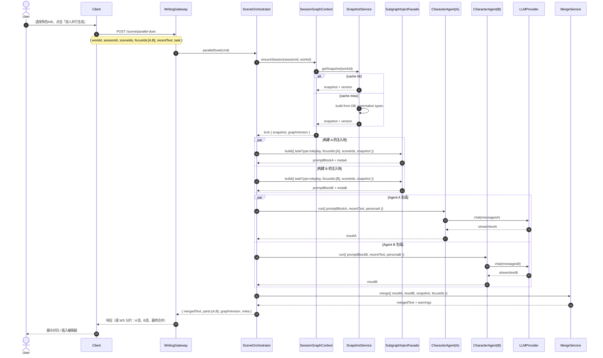
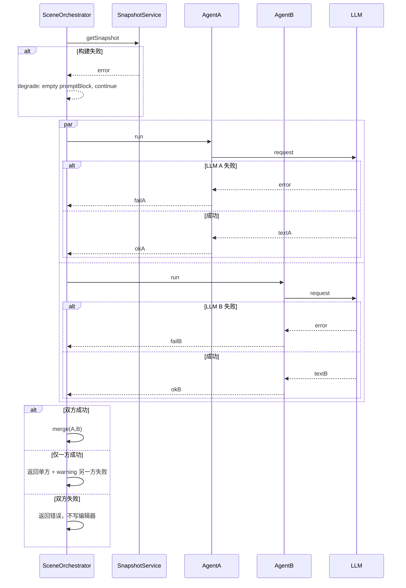

# 双角色并行生成 — 实现级时序图

> 版本：v1.0 · 状态：实现参考（2026-11-25）  
> 项目：StoryForgeAI —— 专业小说 AI 写作软件  
> 类型：编排 / 时序设计  
> 关联：  
> - [多Agent写作中的图谱共享](./多Agent写作中的图谱共享.md)  
> - [子图注入自动化构建流程](./子图注入自动化构建流程.md)  
> - [角色关系图谱实时更新策略](./角色关系图谱实时更新策略.md)  
> - [子图注入Agent的Prompt策略](./子图注入Agent的Prompt策略.md)  
> 说明：描述「场景中两个角色 Agent 并行生成对白/行动」时，从 API 入站到结果合并的实现级调用顺序、锁版本与数据流。

---

## 一、场景定义

**用户意图**：在同一场面下，让角色 A 与角色 B **同时**各生成一段对白或行动，再由编排器合并进正文。

**约束**：

1. 两人读 **同一 graphVersion** 的 L1 快照（关系一致）  
2. 各人 L2 子图按 **策略 B（自我中心）** 构建，focus 不同  
3. 并行阶段 **只读**，不写 L0、不写黑板冲突字段  
4. 飞行中的 LLM 请求 **不** 因关系保存而热替换约束  

**参与组件**：

| 组件 | 职责 |
|------|------|
| `Client` | 工作台 UI |
| `WritingGateway` | HTTP/WS 入站 |
| `SceneOrchestrator` | 编排并行与合并 |
| `SessionGraphContext` | 持有本会话 L1 引用与 version |
| `RelationGraphSnapshotService` | 缓存/构建 snapshot |
| `SubgraphInjectFacade` | 输入 → promptBlock |
| `CharacterAgentRuntime` | 组装消息并调 LLM（A/B 各一实例） |
| `MergeService` | 合并两段输出、可选冲突检测 |

---

## 二、总时序（Mermaid）



---

## 三、分阶段时序说明

### 阶段 1：入站与参数校验（同步）

```text
POST /api/writing/parallel-duet
Body:
{
  "workId": "w_xxx",
  "sessionId": "s_xxx",
  "sceneIds": ["c_lin", "c_he", "c_chen"],
  "focusIds": ["c_lin", "c_he"],
  "recentText": "……雨夜门开……",
  "instruction": "各自说一句对峙的话",
  "stream": true
}
```

校验：`focusIds.length === 2`；focus 属于 work；sceneIds 可选补齐为至少包含 focus。

### 阶段 2：锁定图谱版本（同步，关键）

```text
Orchestrator:
  ctx = SessionGraphContext.get(sessionId)
  // 策略 S2：编排开始时对齐最新
  snap = SnapshotService.getSnapshot(workId)  // 可能 rebuild
  ctx.lockForRun(runId, snap.version, snap)
```

此后本 `runId` 内所有 `Inj.build` / Agent **必须**使用 `ctx.snapshotFor(runId)`，禁止再读「最新缓存」以免 A、B 分到不同 version。

### 阶段 3：并行构建 L2（可并行，CPU 轻）

```text
Promise.all([
  Inject.build({
    taskType: 'roleplay',
    focusIds: [focusIds[0]],
    sceneIds,
    snapshot: lockedSnap,
    maxEdges: 12,
    maxNodes: 8,
  }),
  Inject.build({
    taskType: 'roleplay',
    focusIds: [focusIds[1]],
    sceneIds,
    snapshot: lockedSnap,
    ...
  }),
])
```

**期望**：

- 两边边集对「A—B 关系」描述同源（同一 edge、同一 relationLabel）  
- A 的块以 A 为中心多展示邻居；B 反之  

### 阶段 4：并行 LLM（IO 密集）

```text
Promise.all([
  AgentRuntime.runCharacter({
    characterId: A,
    system: baseRoleplaySystem + promptBlockA,
    user: instruction + recentText,
    temperature: 0.6,
  }),
  AgentRuntime.runCharacter({
    characterId: B,
    system: baseRoleplaySystem + promptBlockB,
    user: instruction + recentText,
    temperature: 0.6,
  }),
])
```

**流式（可选）**：

```text
WS event: { type: 'part_delta', role: 'A', delta: '...' }
WS event: { type: 'part_delta', role: 'B', delta: '...' }
WS event: { type: 'part_done', role: 'A', text: '...' }
WS event: { type: 'part_done', role: 'B', text: '...' }
WS event: { type: 'merged', text: '...' }
```

两路流互不阻塞；合并在 **双方 part_done** 之后。

### 阶段 5：合并与轻量校验

```text
MergeService.merge:
  1. 格式化：
     「林远：……」
     「贺兰策：……」
  2. 可选规则检查：
     - 若 lockedSnap 中 A-B 为 enemy，输出是否出现「好兄弟」「结盟」等违规词表
     - 违规 → warnings[]，不阻断（或降级重试一次，产品定）
  3. 返回 mergedText
```

**不做**：自动写回 relationships；自动改 snapshot。

### 阶段 6：释放运行锁

```text
ctx.unlockRun(runId)
// session 级 snapshot 是否升到 latest 由 S1/S2 策略决定；本 run 已结束
```

---

## 四、序列图（含失败分支）



**原则**：图谱/注入失败 → 降级为空关系块仍生成；LLM 双失败 → 才整体失败。

---

## 五、run 级数据结构

```ts
interface ParallelDuetRun {
  runId: string;
  sessionId: string;
  workId: string;
  graphVersion: string;
  focusIds: [string, string];
  sceneIds: string[];
  promptBlockA: string;
  promptBlockB: string;
  status: 'pending' | 'generating' | 'merging' | 'done' | 'failed';
  resultA?: string;
  resultB?: string;
  mergedText?: string;
  warnings: string[];
}
```

编排器内存或 Redis（TTL 短）保存 run，便于 WS 重连与调试。

---

## 六、与实时更新策略的交叉

```text
时间线：
  t0  lock version=v3，启动并行
  t1  用户在另一页改关系 → cache 变为 v4
  t2  A/B 仍用 v3 完成生成   ✅ 本轮一致
  t3  下一轮 parallel-duet → getSnapshot → v4
```

禁止在 t1→t2 之间替换已发给 LLM 的 system 中的关系块。

---

## 七、时序上的性能要点

| 步骤 | 并行？ | 备注 |
|------|--------|------|
| getSnapshot | 否 | 两 Agent 共享一次 |
| build inject ×2 | 是 | 毫秒级 |
| LLM ×2 | 是 | 主导延迟 |
| merge | 否 | 等双方完成 |

优化：snapshot 预热；相同 `recentText` 不重复打 token 计数日志即可。

---

## 八、实现伪代码（编排核心）

```ts
async function parallelDuet(cmd: ParallelDuetCommand): Promise<ParallelDuetResult> {
  const runId = id();
  const snap = await snapshotService.getSnapshot(cmd.workId);
  const locked = sessionCtx.lockForRun(runId, snap);

  const sceneIds = unique([...(cmd.sceneIds ?? []), ...cmd.focusIds]);
  const [blockA, blockB] = await Promise.all([
    inject.build({
      taskType: 'roleplay',
      focusIds: [cmd.focusIds[0]],
      sceneIds,
      snapshot: locked.snapshot,
    }),
    inject.build({
      taskType: 'roleplay',
      focusIds: [cmd.focusIds[1]],
      sceneIds,
      snapshot: locked.snapshot,
    }),
  ]);

  const [resA, resB] = await Promise.allSettled([
    agent.run({ characterId: cmd.focusIds[0], promptBlock: blockA.promptBlock, ...cmd }),
    agent.run({ characterId: cmd.focusIds[1], promptBlock: blockB.promptBlock, ...cmd }),
  ]);

  sessionCtx.unlockRun(runId);

  const textA = resA.status === 'fulfilled' ? resA.value.text : null;
  const textB = resB.status === 'fulfilled' ? resB.value.text : null;
  if (!textA && !textB) throw new DualGenerateError('both_failed');

  const merged = mergeService.merge({
    textA, textB,
    names: [locked.snapshot.nodes.get(cmd.focusIds[0])?.name,
            locked.snapshot.nodes.get(cmd.focusIds[1])?.name],
    edgeAB: findEdge(locked.snapshot, cmd.focusIds[0], cmd.focusIds[1]),
  });

  return {
    mergedText: merged.text,
    parts: { A: textA, B: textB },
    graphVersion: locked.version,
    warnings: merged.warnings,
  };
}
```

---

## 九、测试检查点（实现验收）

| # | 用例 | 期望 |
|---|------|------|
| 1 | A-B 为 enemy，并行生成 | 两 promptBlock 含同一宿敌 label |
| 2 | 生成中修改关系为同盟 | 本轮输出仍按 enemy 约束（version 锁） |
| 3 | 仅 A 的 LLM 超时 | 返回 B 文本 + warning |
| 4 | snapshot 构建失败 | 空关系块仍尝试生成 |
| 5 | 流式模式 | 先收到双路 delta，最后 merged |
| 6 | sceneIds 含第三人 | 两人 L2 均可带与第三人的 P0/P1 边 |

---

## 十、结论

双角色并行生成的实现要点是：

1. **一次取快照，run 级锁 version**  
2. **两次 inject（不同 focus），并行 LLM**  
3. **双方完成后合并，可选关系违规 warning**  
4. **失败降级：图失败不阻断；单路 LLM 失败可半成功**  

该时序可直接映射为 `SceneOrchestrator.parallelDuet` 的实现骨架，并与现有 Snapshot / Inject / 多 Agent 共享文档一致。

---

## 十一、修订记录

| 版本 | 日期 | 变更说明 |
|------|------|----------|
| v1.0 | 2026-11-25 | 初版：总时序、分阶段、失败分支、伪代码与验收用例 |

---

*配套代码可落在 `SceneOrchestrator.parallelDuet` + `SessionGraphContext.lockForRun`；前端用 WS 事件 `part_delta` / `merged` 展示。*
